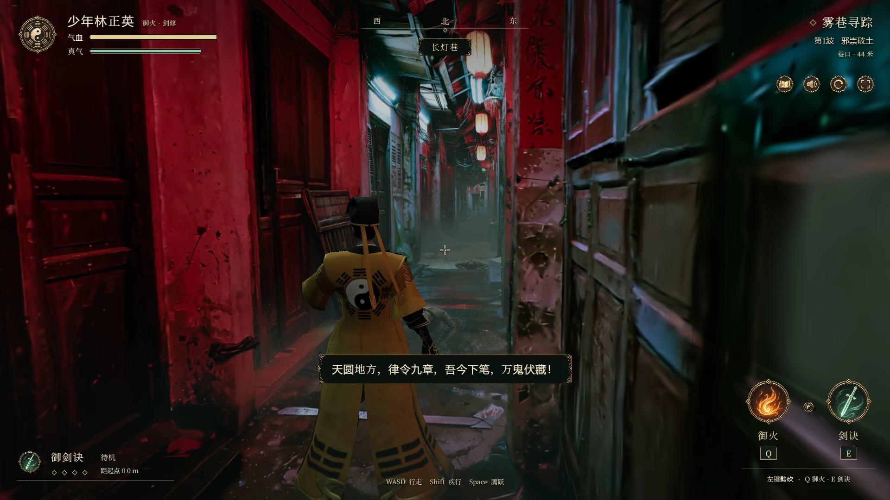

# Taoist Legend — Three.js


A local third-person supernatural martial-arts game: explore a misty lantern-lit alley, cast fireballs, chain crescent sword attacks, and survive waves of emerging nurse enemies.

[简体中文](README.md) · [Architecture](docs/ARCHITECTURE.md) · [Asset inventory](ASSETS.md)

**Current status:** private development archive; no public launch. Original project code and documentation are MIT-licensed. Included third-party and rights-pending assets are not covered by that grant. Public redistribution requires the checks in [the release checklist](docs/PUBLIC_RELEASE_CHECKLIST.md).

## Run locally

Use Node.js 22+ and a WebGL2-capable Chrome/Edge browser with hardware acceleration.

```sh
git clone https://github.com/giuliano1101/taoist-legend-threejs.git
cd taoist-legend-threejs
npm start
```

Open `http://127.0.0.1:4173`. No npm package installation, account, API key, or runtime CDN is required. Do not open the HTML through `file://`. Browsers may require a click/key press before audio can play.

WASD/arrows move; Shift runs; left mouse performs a basic chop; Q casts fire; E/J chains sword attacks; Space jumps; the mouse aims; the wheel adjusts camera distance. Esc/P pauses, M mutes, H opens help, F toggles fullscreen, and R resets the battle.

## Highlights

- Three.js 0.180.0 + Spark 2.4.0; a roughly two-million-Gaussian environment.
- Over-the-shoulder aiming, corridor collision, sampled ground and varied pursuit paths.
- Volumetric mist/fire, procedural sword geometry, particles and dissolve effects.
- Six enemies per wave, staggered underground emergence and interruptible attacks.
- Local music, spatial female enemy cues, synthesized character lines and coherent HTML UI.



The banner is generated promotional artwork, not a gameplay capture. Mobile layouts have been checked; real-device performance is not comprehensively validated. The scene contains baked lighting, and clothing uses skinning/collision corrections rather than full cloth simulation.

`dist/` contains the editable runtime source. `npm run check` audits files, dependencies and privacy patterns; `npm test` checks the local static server. See [CONTRIBUTING](CONTRIBUTING.md), [SECURITY](SECURITY.md), [LICENSE](LICENSE) and [third-party notices](THIRD_PARTY_NOTICES.md).
