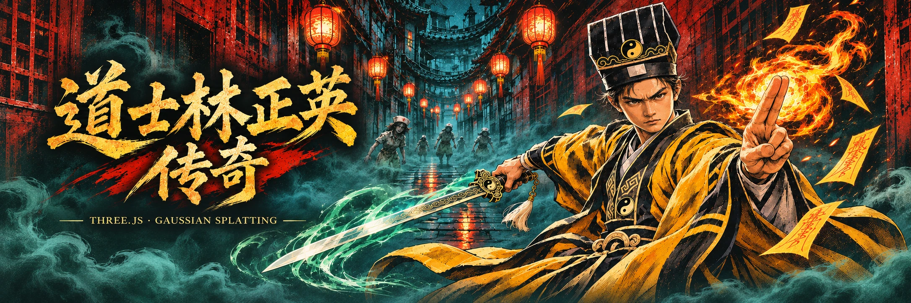
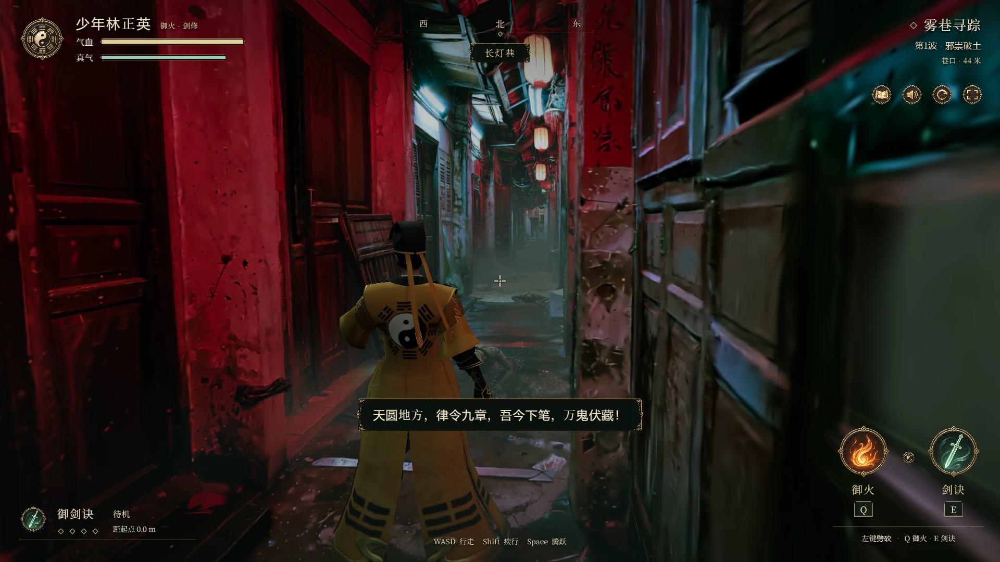
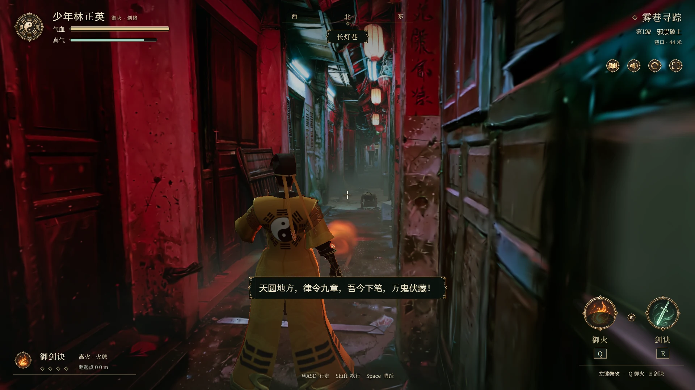
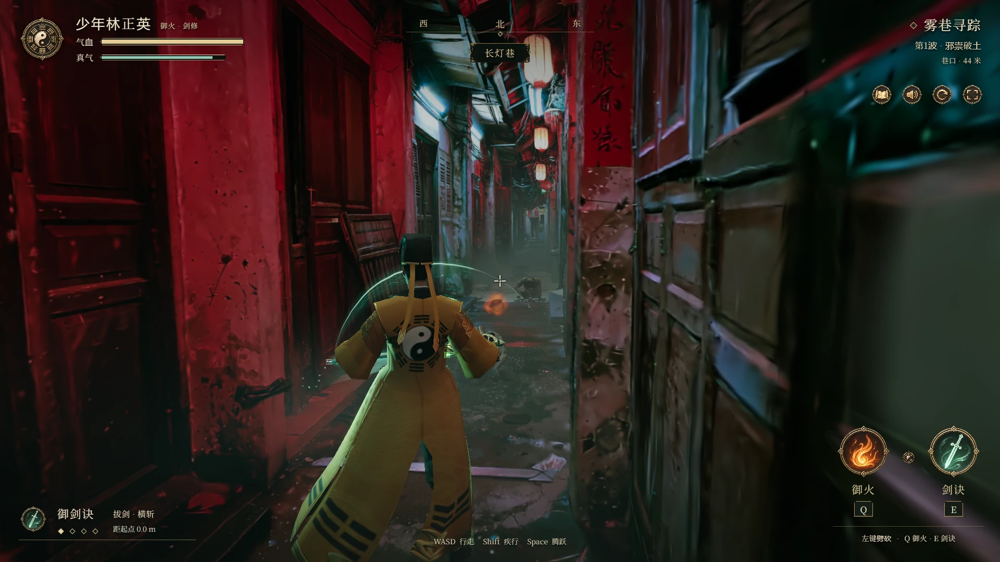

<p align="center"></p>

# 道士林正英传奇

**走进红灯古巷，在流动浓雾里御火、挥剑，迎战破土而来的邪祟。**

一个以港式灵异武侠为创作方向的第三人称 Web3D 动作游戏。Three.js 负责角色、战斗与实时特效，Spark 渲染高斯点云古巷，HTML 与 Web Audio 承载界面和声音。

[English](README.en.md) · [操作与启动](docs/GETTING_STARTED.md) · [架构](docs/ARCHITECTURE.md) · [开发记录](docs/DEVELOPMENT.md) · [素材与许可](ASSETS.md) · [公开前准备](docs/PUBLIC_RELEASE_CHECKLIST.md)

## 玩法

- **越肩探索**：约 54.7 米连续可走古巷，地形采样、墙体避让与相机碰撞。
- **三类攻击**：即时普通劈砍、准星火球、四式月牙剑气连招。
- **连续波次**：开场短暂空场，6 只护士错峰破土、各自追击；击败后进入下一波。
- **动态氛围**：体积雾、湍流火焰、粒子拖尾、技能补光与噪声溶解。
- **完整声音**：本地循环配乐、位置低吼与远处抽泣、参考音色合成的角色念咒。
- **统一界面**：港漫封面、真实加载进度、古铜暗漆 HUD、暂停与帮助、触屏布局。

这些是浏览器中实时运行的功能；顶部展示图是 AI 生成宣传插画，下面是实际开发截图。



| 火球与越肩瞄准 | 月牙剑气 |
| --- | --- |
|  |  |

## 快速开始

需要 **Node.js 22+**、启用硬件加速的 Chrome 或 Edge，以及支持 WebGL2 的桌面设备。运行所需资源已随此私有版本保存；无需 npm 依赖安装、API Key、账号或运行时 CDN。

```sh
git clone https://github.com/giuliano1101/taoist-legend-threejs.git
cd taoist-legend-threejs
npm start
```

打开 `http://127.0.0.1:4173`。Windows 也可双击 `Start-Game.cmd`。不要直接以 `file://` 打开 HTML。首次加载会准备模型、点云、声音、UI 和首帧 GPU 数据。

普通浏览器可能限制自动播放，首次按键/点击可解锁声音。可选的 [Windows 启动器构建](docs/GETTING_STARTED.md#可选windows-启动器)提供独立应用窗口；它仍依赖 Node.js 与浏览器。

| 操作 | 按键 |
| --- | --- |
| 行走 / 奔跑 | WASD 或方向键 / Shift |
| 普通劈砍 | 鼠标左键 |
| 火球 / 四式剑气 | Q / E（J 也可触发剑招） |
| 跳跃 | Space |
| 视角 / 镜头距离 | 鼠标或右键拖动 / 滚轮 |
| 暂停 / 静音 / 帮助 / 全屏 | Esc 或 P / M / H / F |
| 重置战局 / 重播加载与开场 | R / Ctrl+R |

## 项目结构

```text
dist/                 可直接运行的源模块、页面和实际使用资源
  assets/             当前角色、环境、导航、音频、封面与 UI
  vendor/             固定版本的本地第三方库及许可
docs/                 架构、使用、开发记录、介绍文案与展示图
scripts/              静态审计、精简公开导出
tests/                本地服务与路径隔离测试
tools/                可选启动器源码、配乐生成脚本
server.mjs            仅监听回环地址的零依赖静态服务
```

`dist` 中的 JS 即维护用源码，没有隐藏的构建工程。仓库有意排除了历史包、未使用模型和贴图、原电影、人声参考、浏览器配置、机器学习模型及工具运行环境。

## 检查与贡献

```sh
npm run check
npm test
```

请先阅读 [贡献指南](CONTRIBUTING.md)、[安全说明](SECURITY.md) 与 [行为准则](CODE_OF_CONDUCT.md)。这是可玩的本地原型；触屏布局经过开发检查，真实手机性能与所有硬件兼容性尚未全面验证。点云含烘焙光照，衣物采用蒙皮与碰撞修正。

[GitHub Actions 检查模板](docs/ci-check.example.yml) 已提供，当前没有启用自动工作流。

## 许可与后续公开

[LICENSE](LICENSE) 仅许可项目自编代码和文档。Third-party libraries retain their own licenses. 模型、点云、字体、录音、参考音色和宣传图的具体身份见 [ASSETS.md](ASSETS.md) 与 [THIRD_PARTY_NOTICES.md](THIRD_PARTY_NOTICES.md)。游戏名称与人物形象表达不构成任何官方合作或演员背书。

公开前应完成 [发布清单](docs/PUBLIC_RELEASE_CHECKLIST.md)，尤其是附带素材再分发与完整 Git 历史检查。`npm run export:public` 仅生成不含受限游戏素材的本地候选目录，不会发布仓库，也不会生成可玩的完整公开版。
